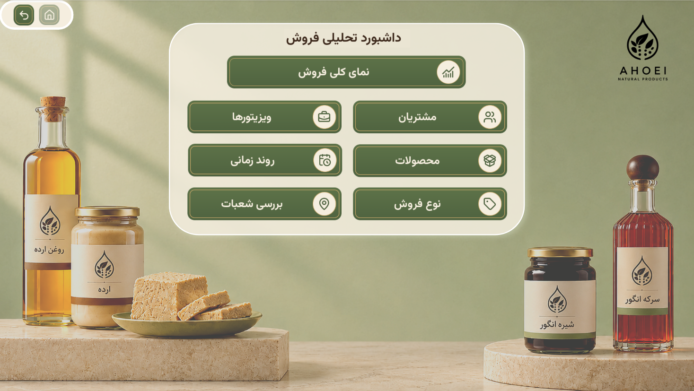
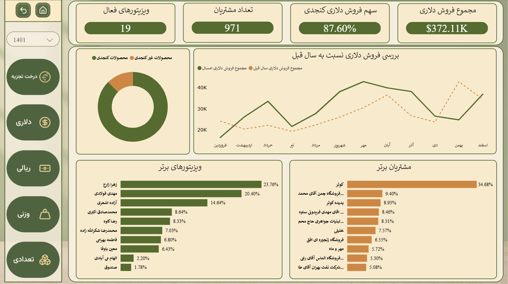
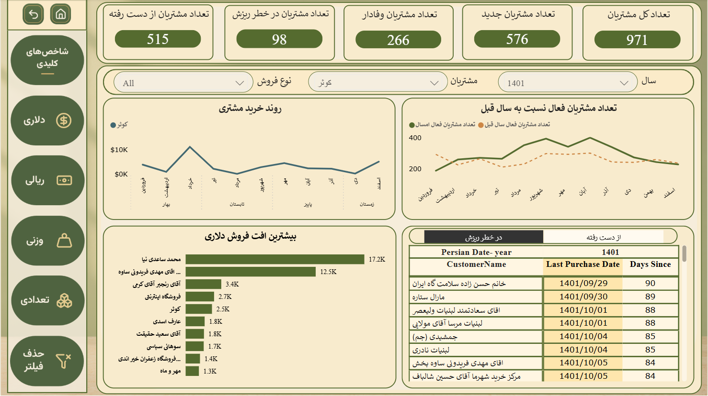
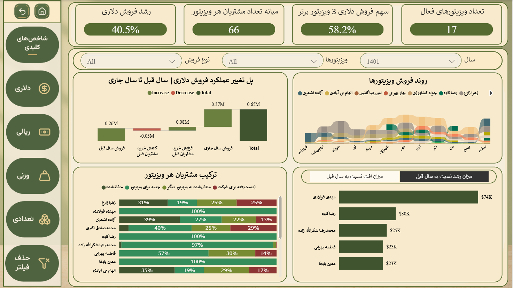
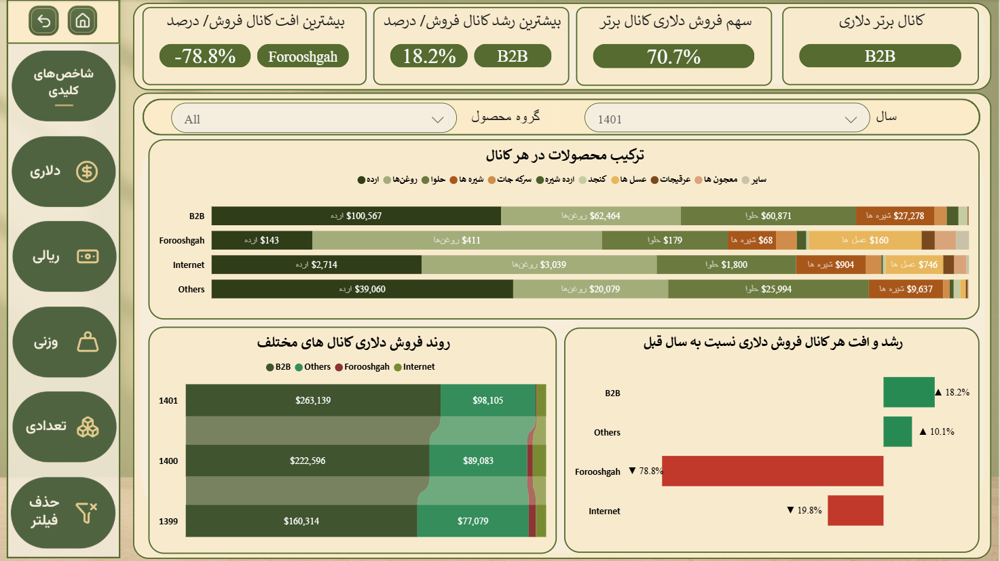
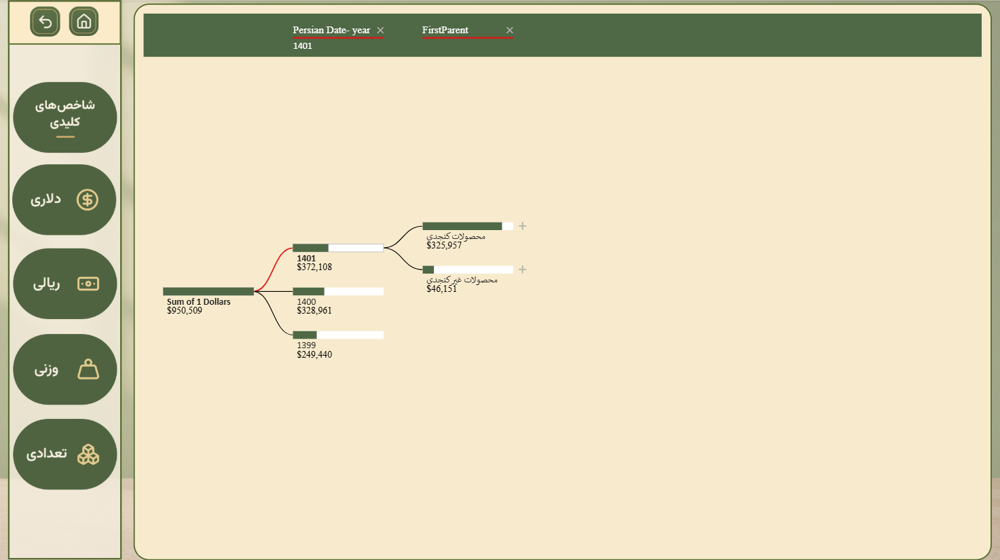
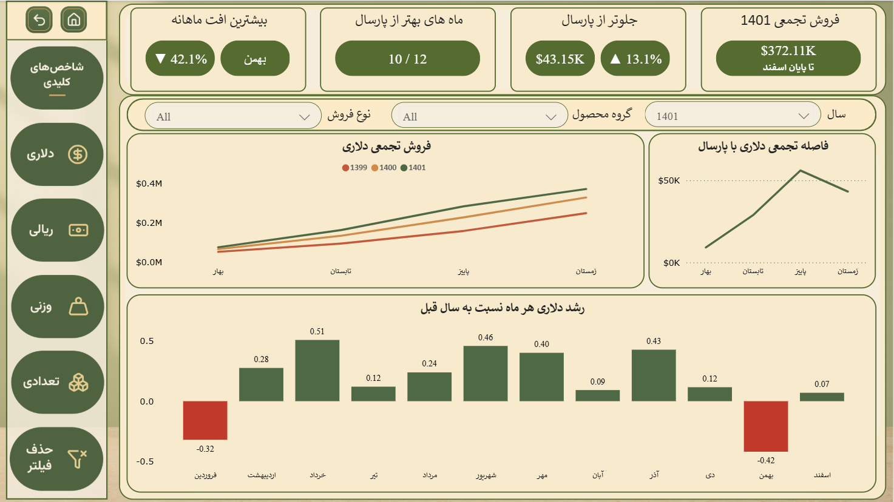
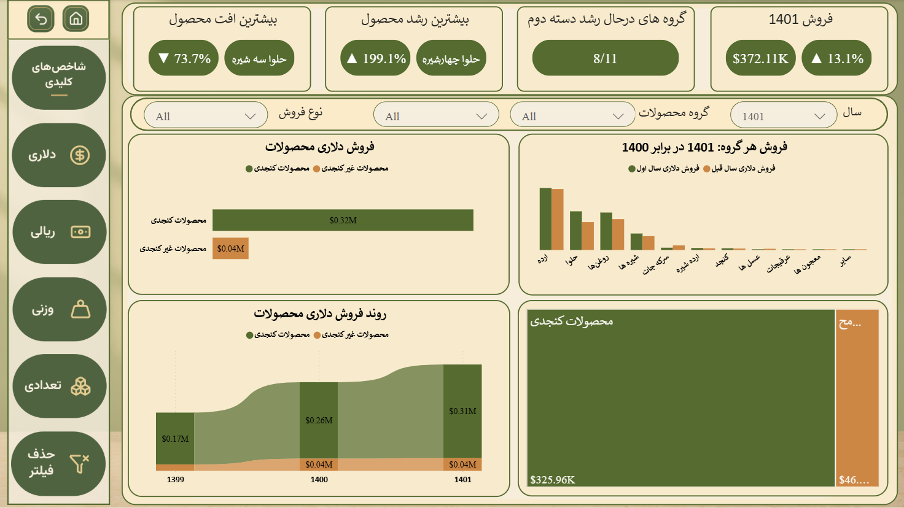
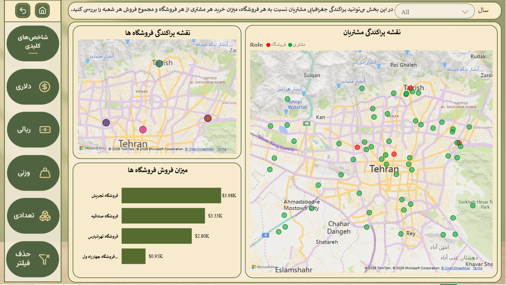

# Project 03 — Power BI Sales Analytics Dashboard

An interactive, nine-page Microsoft Power BI report designed to explore sales performance from multiple business perspectives, including overall results, customers, sales representatives, sales types, products, time trends, and branches.

## Project Overview

This dashboard turns sales data into an interactive report for reviewing key performance indicators (KPIs), comparing performance across periods and business dimensions, and exploring possible drivers behind changes in sales.

To avoid relying on a single metric, the report provides views of **sales value in Rial, sales value in dollars, weight, and quantity**. Users can navigate between the report pages and use available filters and interactive visuals to focus on the areas relevant to their analysis.

## Report Pages

### 1. Menu and Navigation

A landing page that provides visual navigation to the report's main analysis pages, making it easier to move between the different views.

### 2. Sales Overview

A high-level summary of sales performance. KPI cards and summary visuals give a broad view of results, while trends and breakdowns help compare performance by period, product group, customer, and sales representative.

### 3. Customer Analysis

Examines sales at the customer level. The page includes customer activity and sales comparisons, customer-level changes, and purchase-recency information such as the last purchase date and days since the last purchase. These views help identify important customers and customers whose activity or sales may need further review.

### 4. Sales Representative Analysis

Compares sales representatives using multiple measures: quantity, weight, Rial sales value, and dollar sales value. Waterfall and bar-chart views highlight changes in performance, while time-based comparisons show how representative rankings and contributions vary across periods. Customer composition is also included.

### 5. Sales Type Analysis

Explores sales performance by sales type and related business groupings. The visuals compare the composition of sales across quantity, weight, Rial value, and dollar value, and include views of channel-related growth or decline. This makes it possible to compare sales mix and changes without relying on revenue alone.

### 6. Decomposition Tree

Provides an interactive way to investigate a selected sales measure by breaking it down across dimensions such as year, product hierarchy, customer, and sales representative. The decomposition tree supports exploratory analysis of which dimensions contribute to a result or a change.

### 7. Time Trend Analysis

Focuses on how sales change over time. Line and column charts support year-, quarter-, and month-based comparisons, including cumulative sales and measures of change. The page helps users explore trends and compare periods using different sales measures.

### 8. Product Analysis

Compares product performance across the product hierarchy. The page includes product-level comparisons, growth indicators, rankings, time-based views, and treemaps to help explore each product group's contribution and changes in performance.

### 9. Branch Analysis

Examines branch/store performance using map-based views and comparative bar charts. Branches can be compared by quantity, weight, net sales in Rial, and sales value in dollars, providing both a geographic and a performance-based view.

## Key Features

- Nine report pages with visual navigation
- KPI analysis across **Rial sales, dollar sales, weight, and quantity**
- Customer activity, purchase recency, and sales-change analysis
- Sales representative comparisons across multiple measures
- Sales-type and channel-related mix and growth comparisons
- Interactive decomposition-tree analysis
- Time-based trend and cumulative-sales analysis
- Product hierarchy and contribution analysis
- Map-based and metric-based branch comparison

## Tools and Skills

- **Microsoft Power BI Desktop**
- **DAX and KPI measures**
- Data modeling
- Interactive dashboard design
- Data visualization
- Sales performance analysis
- Time-series and comparative analysis

## How to Explore the Report

1. Download the Power BI file using the link below.
2. Open the file with Microsoft Power BI Desktop.
3. Use the report navigation to move between the nine pages.
4. Explore the available filters and interactive visuals to compare measures, periods, customers, sales representatives, products, and branches.

**[Download the Power BI report](./Project%2003.pbix)**

## Author

**Mohammad Amin Mohammadi Ahoei**
